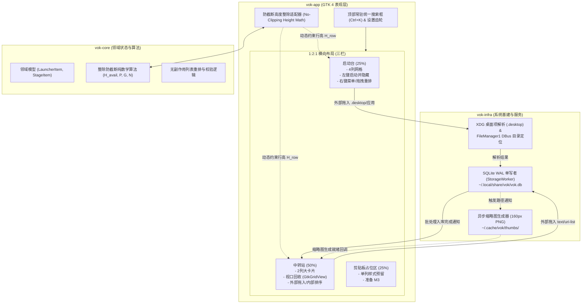

# M1 里程碑实施规划 (Three-Pane Layout, Launcher & Stage Shelf)

> **归档时间**：2026-09-16  
> **基线状态**：M0 宿主内核与外部拖拽中呼出入站已通过实机验收与全量单元测试（Release 二进制 1.5MB，全工作区避让正常）。  
> **核心使命**：将工作台从底层单面板原型演进为具备 1:2:1 三栏布局、防截断高度整除对齐、虚拟滚动视口回收与持久化双流动货架的生产级 MVP。

---

## 1. 核心架构约束与不变量 (Rules & Invariants)

在 M1 的实现全流程中，必须严格恪守以下架构规则：

1. **零 Web 运行时 (R1)**：主界面使用 GTK 4 原生控件与 RenderNode GPU 加速渲染，杜绝任何形式的 Web 技术栈；
2. **引用型流动货架原则 (R4)**：中转站仅保存文件的绝对路径、MIME 类型、大小与元数据引用，**严禁对原文件进行任何移动、重命名、修改或删除**；
3. **SQLite WAL 单写者 (R5)**：写事务全部由后台独立的 `StorageWorker` 线程串行调度，UI 主线程零阻塞；
4. **会话代次绑定 (R6)**：呼出生命周期严格绑定 `GenerationId`，旧代的异步加载、缩略图回调一律丢弃；
5. **视口回收虚拟滚动 (R8)**：启动台与中转站必须使用 GTK4 `GtkGridView` + `GListStore` + `GtkSignalListItemFactory`，屏幕外 Widget 回收复用，确保条目数激增时内存锁死在 `< 40MB`；
6. **卡片高度动态整除算法 (R9)**：启动台与中转站共用高度动态适配算法，确保默认视口最底部一行卡片 100% 完整展现，消除传统 UI 截断半截的瑕疵；
7. **无盲目 sleep (R11)**：全流程由因果事件与异步通道驱动，严禁通过 `thread::sleep` 规避异步时序竞态。

---

## 2. 架构拓扑与交互流



---

## 3. 纵向切片分解与验收门禁

### 切片 1.1：领域模型与卡片防截断动态整除算法 (`vok-core`)
- **目标**：在纯 Rust 内核中定义数据契约与布局整除数学算法，零 UI/系统依赖。
- **交付内容**：
  1. 数据结构：
     - `LauncherItem`：ID、标题、目标路径/DesktopId、图标名称、排序索引；
     - `StageItem`：ID、类型（File/Image/Text）、URI、物理路径引用、显示名称、大小、MIME 类型、修改时间、缩略图路径、排序索引；
  2. 防截断整除算法模块 `NoClippingLayoutCalculator`：
     - 公式：$H_{row} = \left\lfloor \frac{H_{avail} - 2P - (N - 1) \times G}{N} \right\rfloor$；
     - 动态计算最优行数 $N$ 与单行卡片高度 $H_{row}$；
  3. 卡片顺序重排纯逻辑函数。
- **验收门禁**：
  - 覆盖不同屏幕高度与边界情况的单元测试，数学证明最后一行卡片 100% 完整显示。

### 切片 1.2：SQLite WAL 单写者存储与 XDG 目录规范 (`vok-infra::storage`)
- **目标**：建立严格 WAL 事务安全、单写者 Channel 通道的数据持久化引擎。
- **交付内容**：
  1. XDG 规范路径解析：`$XDG_DATA_HOME/vok/vok.db`，自动初始化目录；
  2. 数据库迁移与配置：创建 `launcher_items`、`stage_items` 表，开启 `PRAGMA journal_mode = WAL;`；
  3. `StorageWorker` 单写者 Actor：处理批量入库、单项删除、批量重排事务；
  4. 只读并发查询接口，供 UI 高效拉取初始数据。
- **验收门禁**：
  - 单元测试：并发批量插入 200 项、重排测试、断电/异常退出模拟测试（事务回滚与 WAL 文件检查）。

### 切片 1.3：桌面系统服务集成与缩略图流水线 (`vok-infra::desktop`)
- **目标**：打通 Linux 桌面级 XDG `.desktop` 解析、DBus 文件管理器联动与异步缩略图生成。
- **交付内容**：
  1. `.desktop` 文件解析器：读取系统应用桌面文件，解析 `Name`, `Exec`, `Icon` 属性；
  2. DBus `FileManager1` 客户端：调用 `org.freedesktop.FileManager1.ShowItemLocations` 高亮文件；
  3. 异步缩略图流水线 `ThumbnailWorker`：在 `$XDG_CACHE_HOME/vok/thumbs/` 异步生成 160px PNG，限额 50MB 磁盘配额。
- **验收门禁**：
  - 单元测试与 mock 验证：正确解析常见 `.desktop` 语法；缩略图正常生成并截断尺寸。

### 切片 1.4：主界面 1:2:1 三栏骨架与防截断高度动态联动 (`vok-app::ui`)
- **目标**：重构主窗口布局，构建 1:2:1 三栏容器，并将整除算法挂载至 GTK 渲染管线。
- **交付内容**：
  1. 顶部 Header 区：居中搜索框 `GtkSearchEntry` 与右上角设置齿轮按钮；
  2. 水平三栏容器：按照 `1:2:1` 划分【启动台 (25%)】、【中转站 (50%)】、【剪贴板占位 (25%)】；
  3. 动态高度整除联动：根据分配尺寸计算 $H_{row}$ 并动态约束卡片高度，消除半截截断。
- **验收门禁**：
  - 实机运行并在不同窗口尺寸/缩放比下拖拽调整，启动台与中转站底部完全无裁切，呈现整行闭合。

### 切片 1.5：启动台 (Launcher) 货架功能闭环 (`vok-app::launcher`)
- **目标**：落地启动台 4 列网格、点击启动自动隐藏、右键上下文菜单与外部拖入。
- **交付内容**：
  1. 视图实现：`GtkGridView` 固定 4 列排布，使用 `GListStore` 与 `GtkSignalListItemFactory`；
  2. 交互行为：
     - 左键单击：启动目标应用/打开文件，同时自动隐藏面板；
     - 右键菜单：【启动】、【打开所在目录】、【移除该项】；
     - 外部拖入添加：支持拖入 `.desktop` 文件或普通文件/脚本，解析后存入数据库；
     - 内部拖拽排序：支持卡片拖拽重排并同步持久化 `order_index`。
- **验收门禁**：
  - 单击启动项能正常拉起目标应用且工作台瞬间自动隐藏；右键移除能即时从数据库与界面删除。

### 切片 1.6：中转站 (Stage) 流动货架完整闭环 (`vok-app::stage`)
- **目标**：落地中转站核心流动货架，支持 2 列大卡片、原生视口回收、秒级拖入入库与异步缩略图渲染。
- **交付内容**：
  1. 视图实现：`GtkGridView` 双列卡片，展示文件图标/160px 缩略图、文件名、大小、修改时间；
  2. 外部拖入增强：拖入 `FileList` 直接投递给 `StorageWorker` 异步批量入库，严格遵守引用原则；
  3. 右键上下文菜单：【打开】、【打开所在目录】、【复制到剪贴板】、【从货架移除】；
  4. 内部拖拽排序：支持中转项在网格内拖拽调整展示顺序。
- **验收门禁**：
  - 单次拖入 50 个大文件，UI 完全不卡顿，1 秒内完成入库并渲染；缩略图后台逐个平滑刷出。

### 切片 1.7：M1 全链路集成、门禁验收与基准压测
- **目标**：端到端整合三大 Crate，跑通完整业务流并验证 M1 全部量化门禁。
- **交付内容**：
  1. 启动流程整合：数据库初始化 -> 载入持久化数据 -> 启动后台 Worker -> 构建主界面 -> 注册快捷键与工作区避让；
  2. 验收门禁执行与断言：
     - [ ] **防截断验证**：实机多工作区下，启动台与中转站底部卡片 100% 完整展示；
     - [ ] **性能指标验证**：单次拖入 50 个文件入库耗时 $< 1\text{s}$，主线程无明显丢帧（60fps）；
     - [ ] **数据与安全验证**：连续增删重排 200 项无异常，断言原文件未发生任何修改；
     - [ ] **内存常驻指标**：虚拟滚动加载上百条数据，应用空闲内存稳定在 $< 40\text{MB}$。

---

## 4. 依赖时序拓扑

```text
[切片 1.1: 领域模型与整除算法] ────┐
                                    ├─► [切片 1.4: 1:2:1 骨架与整除对齐] ──┐
[切片 1.2: SQLite WAL 存储引擎] ───┤                                      │
                                    ├─► [切片 1.5: 启动台货架功能闭环] ─────┼─► [切片 1.7: M1 验收与门禁]
[切片 1.3: 桌面服务与缩略图流水] ──┘                                      │
                                    └─► [切片 1.6: 中转站流动货架闭环] ─────┘
```
