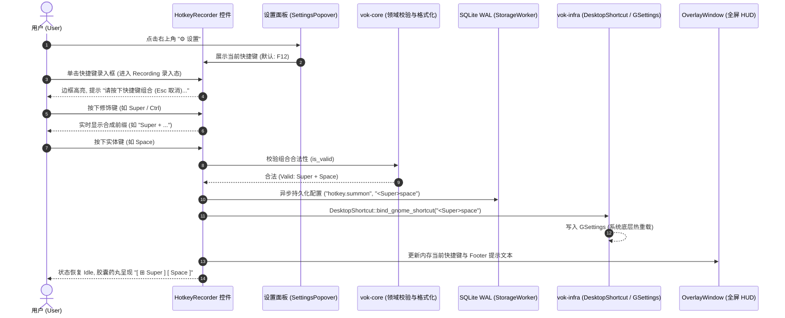

# 切片 S3 实施规划：可视化快捷键自定义与录入交互组件 (HotkeyRecorder)

> **基线状态**：切片 S1（任务栏隐形）与切片 S2（系统托盘常驻）已于 2026-09-16 闭环交付，全屏 HUD 直角与净工作区无缝覆盖已于 2026-09-17 完成（决策 §10, §11, §12）。  
> **核心使命**：彻底解耦硬编码的 `F12` 快捷键，落地纯原生领域契约、GNOME D-Bus 动态热重载与现代化 GTK4 可视化录入控件（`HotkeyRecorder`），实现用户免重启自定义专属呼出组合键。

---

## 1. 痛点诊断与设计边界

### 1.1 现状与痛点
1. **键盘布局与物理差异**：目前呼出快捷键硬编码为 `F12`。在 60%/65% 紧凑型配列、Mac 布局外接键盘、某些轻薄本（默认媒体键，需按 `Fn+F12`）上极其别扭甚至无法直接单手触发；
2. **缺乏可视化录入与即时反馈**：普通用户无法直观了解当前生效的快捷键，更无法直接按下心仪的组合键（如 `Super + Space`、`Ctrl + Space`、`Alt + Space`、`Ctrl + Grave`）完成配置；
3. **不能要求重启进程**：快捷键修改后必须零延迟动态更新底层系统按键监听器（GNOME GSettings / evdev），不得要求用户重启常驻守护进程。

### 1.2 架构边界与不变量守则
- **零 Web 运行时 (R1)**：组件完全由 GTK 4 原生控件渲染，基于 RenderNode 硬件加速；
- **分层与零依赖 (R11)**：`vok-core` 建立纯领域模型，不依赖任何 GTK 或系统底层库；
- **SQLite WAL 单写者事务通道 (R5)**：快捷键持久化纳入 `app_settings` 表，由 `StorageWorker` 单写者串行处理；
- **极速响应不打折 (决策 §11)**：快捷键动态重载后，呼出链路始终保持调用常驻 GApplication D-Bus Action `toggle`，维持 **8ms** 的极速响应。

---

## 2. 核心架构拓扑与交互流



---

## 3. 详细设计与模块落地方案

### 3.1 领域契约与解析校验器 (`vok-core::hotkey`)

在 [`vok-core/src/hotkey.rs`](file:///home/lin/dev/vok/crates/vok-core/src/hotkey.rs) 扩展纯领域数据结构与算法：

```rust
/// 修饰键标志位集合
#[derive(Debug, Clone, Copy, PartialEq, Eq, Default, Hash)]
pub struct ModifierMask {
    pub ctrl: bool,
    pub alt: bool,
    pub shift: bool,
    pub super_key: bool,
}

impl ModifierMask {
    pub fn is_empty(&self) -> bool {
        !self.ctrl && !self.alt && !self.shift && !self.super_key
    }
}

/// 快捷键领域配置模型
#[derive(Debug, Clone, PartialEq, Eq, Hash)]
pub struct HotkeyConfig {
    pub modifiers: ModifierMask,
    pub key_name: String,       // 标准键名，如 "space", "F12", "k", "grave"
    pub keyval: u32,           // X11 / GDK 键值码
}

impl HotkeyConfig {
    /// 默认全局唤醒快捷键 (F12)
    pub fn default_summon() -> Self;

    /// 转换为 GNOME / XDG GSettings 规范格式字符串 (如 "<Super>space", "F12", "<Control><Alt>k")
    pub fn to_gsettings_string(&self) -> String;

    /// 从 GSettings 格式解析还原领域模型
    pub fn from_gsettings_string(s: &str) -> Result<Self, HotkeyParseError>;

    /// 转换为人类友好的 UI 展示字符串 (如 "Super + Space", "Ctrl + Alt + K", "F12")
    pub fn to_display_string(&self) -> String;

    /// 校验快捷键组合的合法性与安全性
    /// 
    /// 规则：
    /// 1. 功能键 F1 ~ F24 允许单键直接绑定；
    /// 2. 普通按键 (字母、数字、符号、空格、Tab 等) 必须至少搭配 Ctrl / Alt / Super 之一；
    /// 3. 单纯的修饰键不能成键；
    /// 4. 严禁单独绑定危险键 (Esc, BackSpace, Return 等)。
    pub fn is_valid(&self) -> bool;
}
```

### 3.2 持久化存储与配置表 (`vok-infra::storage`)

在 [`vok-infra/src/storage/schema.rs`](file:///home/lin/dev/vok/crates/vok-infra/src/storage/schema.rs) 增补配置表：

```sql
-- 通用配置表 (WAL 单写者模式，支持未来扩展主题、自启等)
CREATE TABLE IF NOT EXISTS app_settings (
    key TEXT PRIMARY KEY,
    value TEXT NOT NULL,
    updated_at_ms INTEGER NOT NULL
);
```

在 [`vok-infra/src/storage/client.rs`](file:///home/lin/dev/vok/crates/vok-infra/src/storage/client.rs) 增加配置读写接口：
- `pub fn get_setting(&self, key: &str) -> Result<Option<String>, StorageError>`
- `pub fn set_setting(&self, key: &str, value: &str) -> Result<(), StorageError>`

由 [`vok-infra/src/storage/worker.rs`](file:///home/lin/dev/vok/crates/vok-infra/src/storage/worker.rs) 独占写事务串行落盘。

### 3.3 系统快捷键动态热重载 (`vok-infra::desktop::shortcut`)

重构 [`vok-infra/src/desktop/shortcut.rs`](file:///home/lin/dev/vok/crates/vok-infra/src/desktop/shortcut.rs)：
- `DesktopShortcut::bind_gnome_shortcut(binding: &str) -> bool`：
  - 更新 `org.gnome.settings-daemon.plugins.media-keys.custom-keybinding:/vok/ binding`；
  - 自动维护 `custom-keybindings` 列表；
  - 保持底层命令为 D-Bus 极速触发：`gdbus call ... Activate 'toggle' [] {}`。
- `DesktopShortcut::read_current_gnome_shortcut() -> Option<String>`：
  - 读取系统当前绑定的快捷键。

### 3.4 可视化录入交互组件 (`vok-app::ui::hotkey_recorder`)

新建 [`vok-app/src/ui/hotkey_recorder.rs`](file:///home/lin/dev/vok/crates/vok-app/src/ui/hotkey_recorder.rs)：
- **组件结构**：
  - 根容器：带有胶囊质感的暗色交互卡片；
  - 视觉呈现区：显示快捷键键帽药丸（如 `[ ⊞ Super ]` `[ Space ]`）；
  - 状态指示器：在录入时展示脉冲发光边框与提示；
  - 清除/重置按钮：提供快速重置为默认 `F12` 的按钮。
- **状态机与按键捕获**：
  - 挂载 `EventControllerKey`；
  - **点击聚焦** -> 进入 `Recording` 状态；
  - **按下按键 (`key_pressed`)**：
    - 若按下的是修饰键（Ctrl/Alt/Shift/Super），提取当前修饰键掩码，UI 动态显示 `Ctrl + ...`；
    - 若按下 `Escape`：放弃录入，恢复原配置；
    - 若按下实体键：根据当前掩码与实体键名构建 `HotkeyConfig`；
    - 调用 `is_valid()` 进行安全校验；
    - 校验通过 -> 触发提交，退出录入状态，通知外部回调；
    - 校验未通过（如仅按单字母 'p'） -> UI 提示“普通按键需搭配修饰键”。
  - **失焦处理**：录入过程中鼠标点击外部失焦，自动取消录入并还原。

### 3.5 设置面板宿主 (`vok-app::ui::settings_popover`)

新建 [`vok-app/src/ui/settings_popover.rs`](file:///home/lin/dev/vok/crates/vok-app/src/ui/settings_popover.rs)：
- 挂载在 [`vok-app/src/ui/header.rs`](file:///home/lin/dev/vok/crates/vok-app/src/ui/header.rs) 的 `settings_btn` ("⚙ 设置") 上；
- 使用 `gtk4::Popover` 实现沉浸式下拉浮层；
- 内嵌 `HotkeyRecorder` 控件、系统热键通道状态（"已生效：GNOME 系统全局热键 · 8ms"）及关于信息；
- 避免弹窗破坏 HUD 全屏工作区或抢占 X11 窗口层级。

### 3.6 全屏主窗口 HUD 动态同步 (`vok-app::overlay`)

在 [`vok-app/src/overlay.rs`](file:///home/lin/dev/vok/crates/vok-app/src/overlay.rs) 中：
- 内存持有当前的 `Rc<RefCell<HotkeyConfig>>`；
- 在窗口内的 `key_controller` 中，除 Esc 之外，动态比对当前按下的键是否与呼出热键一致，支持窗口内再次按键 Toggle 关闭；
- 底部状态栏 `footer_label` 动态更新为最新快捷键名称。

---

## 4. 实施阶段分解与时序

```text
[阶段 1: 领域契约与解析校验] ─── vok-core::hotkey
             │
[阶段 2: 存储与系统通道重载] ─── vok-infra::storage & desktop::shortcut
             │
[阶段 3: HotkeyRecorder 交互控件] ── vok-app::ui::hotkey_recorder
             │
[阶段 4: 设置面板与 HUD 动态联动] ─ vok-app::ui::settings_popover & overlay
             │
[阶段 5: 单元测试、门禁压测与实机验证]
```

---

## 5. 验收门禁规划 (Acceptance Matrix)

| 门禁 ID | 验收项 | 验证手段 | 预期指标 |
|---|---|---|---|
| **GATE-S3-1** | 领域序列化与解析准确性 | `vok-core` 单元测试 | F12、`<Super>space`、`<Control><Alt>k` 等双向解析 100% 正确 |
| **GATE-S3-2** | 快捷键合法性安全拦截 | `vok-core` 边界测试 | 单字母、单修饰键、危险单键 (Esc/Enter) 严格判定为非法并拦截 |
| **GATE-S3-3** | WAL 配置存储与读写 | `vok-infra` 单元测试 | `app_settings` 表读写无死锁，写入后持久存在 |
| **GATE-S3-4** | GNOME GSettings 动态生效 | 系统执行与命令验证 | 修改快捷键后 `gsettings get` 立即反映，免重启即刻呼出 |
| **GATE-S3-5** | 录入交互体验与取消闭环 | 实机交互操作 | 点击录入有高亮提示，输入组合键精准捕获，按 Esc 完美取消 |
| **GATE-S3-6** | HUD 极速响应性能 | D-Bus 激活耗时压测 | 自定义快捷键后触发耗时依然维持在 **< 16ms**（实测 ~8ms） |
